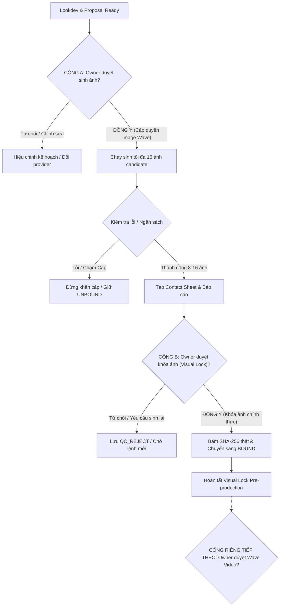

# ĐỀ XUẤT SẢN XUẤT ẢNH REFERENCE THIẾT KẾ (IMAGE REFERENCE SOURCING PROPOSAL)
## DỰ ÁN PHIM *NHẤT KIẾM PHÁ VÂN* (XIANXIA60 — 60.0 GIÂY / 12 SHOT DUEL)

**Ngày lập đề xuất:** 2026-10-20
**Tác giả:** Gemini Flash 3.8 (Worker)
**Worker worktree:** `D:\AI FILM MAKER\AI-Film-Pipeline-Film120-Gemini`
**Worker branch / commit:** `feature/film120-gemini-realshot-001@e5df390dbdd097cd429a56d42798f29c1c904a99`
**PINNED POLICY_REF:** `45f71d6226c5ffc58b4e70f3bcea1bb0151b7003` (Blob SHA: `6cab2103e32448a10e13b7f00c1a3eb4adb4a221`)
**Mục tiêu vận hành:** Lựa chọn **Phương án B** của Owner — Lập gói đề xuất có kiểm soát chặt chẽ cho đợt sinh ảnh tham chiếu nhân vật và bối cảnh (Image Reference Sourcing Wave).
**Quy chế tuân thủ tuyệt đối:** **CHỈ LẬP KẾ HOẠCH & TIỀN KỲ (PLANNING / PRE-FLIGHT ONLY). KHÔNG GỌI API SINH ẢNH, KHÔNG SINH VIDEO, 0 CHI PHÍ, 0 TRUY CẬP PHIÊN DUYỆT TRÌNH/COOKIE, 0 AUTO-RETRY.**

---

## 1. So Sánh & Khuyến Nghị Các Tùy Chọn Provider Sinh Ảnh Reference

Hệ thống đánh giá trung thực các phương án provider khả thi, bám sát các khế ước sẵn có trong kho mã nguồn (`docs/sot/film/06_PROVIDER_CAPABILITIES.md`, `src/film_pipeline/providers/`):

| Tiêu Chí Đánh Giá | Tùy Chọn 1: Dola / Dreamina (Seedance Image) | Tùy Chọn 2: Flow / Imagen 3 (Google Ecosystem) | Tùy Chọn 3: Midjourney v6.x (Operator Offline) | Tùy Chọn 4: Flux.1 [dev/schnell] (Direct API) |
| :--- | :--- | :--- | :--- | :--- |
| **Mục đích sử dụng** | Sinh ảnh chân dung, trang phục và tư thế kiếm hiệp mang đậm thẩm mỹ Á Đông (Cổ Phong Tiên Hiệp). | Sinh ảnh chất lượng điện ảnh, kết cấu đá sương mù và ánh sáng tán xạ tự nhiên. | Sinh bộ ảnh ý niệm và chân dung đồng nhất cao độ qua tham số `--cref` và `--sref`. | Sinh ảnh giải phẫu chính xác, kiểm soát hạt sạn và vũ khí hình học thẳng thớm. |
| **Thế mạnh kỳ vọng** | Rất mạnh về văn hóa kiếm hiệp, nếp áo đạo bào, kiếm khí và kiểu tóc cổ phong; adapter đã có trong repo (`dola_production`). | Độ chân thực cao về da mặt, ánh sáng sương mù tự nhiên, không bị hiệu ứng hoạt hình/neon rẻ tiền. | Tính nhất quán khuôn mặt (`--cref`) và phong cách mỹ thuật vượt trội, đạt chuẩn visual lock cao nhất. | Kiểm soát prompt chặt chẽ, chi phí minh bạch tính theo từng request API, hỗ trợ seed cố định. |
| **Rủi ro & Điểm yếu** | Phụ thuộc phiên duyệt trình (session/captcha); hạn mức và quota thực tế hiện tại là **UNKNOWN**. | Rủi ro trôi dạt hợp đồng RPC private; kiểu tóc và giáp vai tiên hiệp có thể bị lai tạp nếu prompt lỏng; quota: **UNKNOWN**. | Không có adapter tự động hóa trong repo; bắt buộc thực hiện thủ công qua Discord/Web; cần tài khoản trả phí. | Chưa có adapter sẵn trong `src/film_pipeline/providers/`; cần cấu hình khóa API và nạp tiền trả trước; quota: **UNKNOWN**. |
| **Độ nhất quán nhận diện (Character Consistency)** | **Khá - Tốt**: Khả năng giữ nét khuôn mặt Á Đông tốt qua tính năng reference ảnh của giao diện. | **Trung bình**: Giữ được phong cách chung, nhưng có thể lệch chi tiết mặt giữa góc nghiêng và góc chính diện. | **Rất mạnh**: Công cụ `--cref` hiện là tiêu chuẩn cao nhất để neo giữ khuôn mặt qua nhiều góc chụp. | **Khá**: Cần kết hợp kỹ thuật LoRA hoặc IP-Adapter nếu muốn giữ chính xác 100% gương mặt. |
| **Tương thích Video Conditioning tiếp theo** | **KNOWN / CAO**: Tương thích trực tiếp với video transport `seedance_dola` (`supports_image_input: true`). | **KNOWN / CAO**: Tương thích trực tiếp với video transport `flow_veo` (Veo 2 nhận ảnh frame đầu từ thư viện). | **UNKNOWN / GIÁN TIẾP**: Phải tải ảnh về máy cục bộ, kiểm tra SHA rồi mới đưa vào pipeline video. | **UNKNOWN / GIÁN TIẾP**: Phải tải ảnh về máy cục bộ, kiểm tra SHA rồi mới đưa vào pipeline video. |

### Đánh Giá Thực Tế & Khuyến Nghị Provider:
- **Khuyến nghị chính (Automated Route):** **Dola / Dreamina Image Route** là lựa chọn phù hợp nhất cho dự án nếu Owner muốn tận dụng adapter tự động hóa sẵn có trong repo và thế mạnh thẩm mỹ Tiên Hiệp Á Đông, với điều kiện phải thực hiện preflight kiểm tra quota/tín dụng trước khi chạy.
- **Khuyến nghị bổ trợ (High-Quality Manual Option):** Nếu Owner ưu tiên độ nhất quán khuôn mặt tuyệt đối giữa 3 góc chụp (chính diện, 3/4, nghiêng) trước khi bước vào video, **Midjourney v6.x (với `--cref`) do Operator thực hiện thủ công ngoại tuyến** là phương án mang lại độ an toàn mỹ thuật cao nhất, sau đó nhập file vào kho lưu trữ của pipeline.
- *Ghi chú trung thực về hạn mức:* Trạng thái số dư tài khoản, hạn mức khả dụng và chi phí chính xác của mọi provider tại thời điểm này đều được ghi nhận là **UNKNOWN** do tuân thủ nghiêm ngặt quy tắc không gọi mạng thăm dò trái phép.

---

## 2. Phạm Vi Tài Sản Reference Cần Thu Thập (Proposed Asset Scope)

Để phục vụ trọn vẹn 12 cảnh quay của phim *Nhất Kiếm Phá Vân* theo đúng thiết kế ngoại hình đã được Tech Lead nghiệm thu, đợt sinh ảnh tập trung vào **8 góc nhìn mục tiêu (Target Views)**:

### 2.1. Nhân Vật Lý Phá Vân (`WHITE_CULTIVATOR` — Bạch Y Kiếm Tu)
1. **Ảnh Chân Dung Chính Diện (Front Facial Portrait):**
   - Độ tuổi 21–24 tuổi, gương mặt thanh tú, xương hàm thon gọn sắc nét, sống mũi thẳng, ánh mắt tĩnh lặng trầm mặc.
   - Tóc đen búi cao trong Ngân Quan (trâm bạc khắc mây), hai dải lụa đen rủ sau lưng.
   - Cổ áo chéo màu lam ngọc nhạt (`#81D4FA`) bên trong lớp áo lanh trắng ngà (`#E0E7ED`).
2. **Ảnh Toàn Thân / Ba Phần Tư Tư Thế Kiếm (Three-Quarter Action Stance):**
   - Vóc dáng thon gọn thanh thoát (178cm), tư thế đứng thủ bộ kiếm tiêu sái, trọng tâm cân bằng.
   - Bạch y đạo bào nhiều lớp lụa crepe (`#F8F9FA`), tà áo xẻ khí động học bay nhẹ theo gió núi; đai lụa trắng móc ngọc bội; bao tay da bạc sẫm siết chặt cổ tay.
   - Tay cầm Thanh Sương Kiếm (trường kiếm thẳng hai lưỡi 92cm, chuôi ngọc cừu trắng viền chỉ bạc).
3. **Ảnh Góc Nghiêng (Side / Profile View):**
   - Đường nét khuôn mặt góc nghiêng sắc nét, sống mũi cao, búi tóc ngân quan và dải lụa buông rủ; hòa quyện trong làn sương sớm mờ ảo.

### 2.2. Nhân Vật Dạ Vô Nhai (`BLACK_CULTIVATOR` — Hắc Y Kiếm Tu)
4. **Ảnh Chân Dung Chính Diện (Front Facial Portrait):**
   - Độ tuổi 27–29 tuổi, gương mặt góc cạnh từng trải, hốc mắt sâu với ánh nhìn chim ưng dữ dội uy nghiêm, cằm chẻ cương nghị.
   - Tóc đen thô cứng chấm vai, nửa trên buộc kẹp sắt huyền thiết xám, lọn tóc mai bay ngang gò má.
   - Cổ áo twill màu xám than củi (`#2B2B2B`) và vạt áo đen hắc diệu thạch (`#1C1D21`).
5. **Ảnh Toàn Thân / Ba Phần Tư Thế Đứng Chiến Đấu (Three-Quarter Action Stance):**
   - Thân hình vạm vỡ bờ vai rộng (185cm), thế đứng hạ thấp trọng tâm vững như bàn thạch.
   - Huyền sắc võ bào thô nặng, vai phải mang giáp da thuộc đen luộc cứng đính đinh tán đồng cổ (`#3E2723`), dây đai da chéo ngực, ủng chiến đấu bọc sắt.
   - Hai tay nắm đốc Huyền Minh Kiếm (trọng kiếm huyền thiết thiên thạch dài 105cm, bản rộng 14cm có rãnh huyết tống sâu).
6. **Ảnh Góc Nghiêng (Side / Profile View):**
   - Góc nghiêng tôn lên bờ vai dày, giáp vai da thuộc đơn bên phải và các nếp gấp áo khoác nặng chịu ma sát.

### 2.3. Không Gian Đấu Trường Vân Đài (`LOC_VAN_DAI_TERRACE`)
7. **Toàn Cảnh Đấu Trường (Wide Establishing Look):**
   - Thạch đài tròn đường kính 30m lát đá granite xám sẫm ngàn năm rêu phong, lan can đá thấp (0.7m) viền quanh vực sâu.
   - Biển mây cuộn trào vô tận dưới chân núi ở độ cao ~2,800m.
8. **Địa Hình Điểm Mốc & Khí Quyển (Atmosphere & Geography Look):**
   - Phía Bắc là các đỉnh núi nhọn hoắt đâm xuyên tầng sương mù; phía Đông là thạch trụ rồng mây (4m) đón ánh bình minh; ánh sáng sớm lam xám lạnh (6800K).

### Số Lượng Ảnh Đề Xuất:
- **Số lượng ảnh tối thiểu bắt buộc khóa (Minimum Reference Set):** **8 ảnh** (đáp ứng đúng 8 góc nhìn trên để ánh xạ vào 5 canonical ID của sổ bộ tài sản).
- **Số lượng ảnh sinh tối đa trong wave (Maximum Candidate Pool):** **16 ảnh** (mỗi góc nhìn sinh tối đa 2 biến thể candidate để Owner lựa chọn bức ảnh xuất sắc nhất).

---

## 3. Cơ Chế Kiểm Soát Request, Retry & Ngân Sách (Spend & Request Controls)

Nhằm loại bỏ hoàn toàn tình trạng tiêu hao ngân sách hoặc spam API mất kiểm soát, gói thực thi được đóng khung với các thông số bất biến:

1. **Giới hạn số lượng request tối đa (Max Requests Cap):**
   - **Tối đa 16 requests duy nhất** cho toàn bộ đợt (tương ứng 2 biến thể cho mỗi góc nhìn trong 8 mục tiêu).
2. **Giới hạn số lượng ảnh đầu ra tối đa (Max Output Images):**
   - **Tối đa 16 tệp ảnh candidate** được lưu xuống đĩa để Owner nghiệm thu.
3. **Quy chế gộp mẻ (Batching Rule):**
   - Cho phép chạy tuần tự từng prompt có kiểm soát (sequential batching). Tuyệt đối **cấm chạy song song đồng thời (no parallel concurrency flooding)** để tránh nghẽn mạng và vi phạm rate-limit của provider.
4. **Quy tắc tuyệt đối không tự động thử lại (Zero Automatic Retries):**
   - **Số lần auto-retry = 0**. Bất kỳ lỗi mạng, lỗi timeout, HTTP 4xx/5xx hay lỗi trả về từ phía provider đều được xử lý dừng ngay lập tức.
5. **Cơ chế đóng cổng khi có lỗi (Fail-Closed Rule):**
   - Nếu provider trả về lỗi hoặc hình ảnh không đọc được, hệ thống kích hoạt trạng thái `FAIL_CLOSED_HALT`, dừng wave tức thì, không gửi thêm bất kỳ request nào tiếp theo. Hồ sơ tài sản giữ nguyên trạng thái `UNBOUND`.
6. **Trần ngân sách cứng (Hard Budget Cap):**
   - **Trần ngân sách tối đa: $3.00 USD**.
   - Nếu sử dụng hạn mức miễn phí có sẵn (Daily Promotional Credits): **$0.00**.
   - Nếu sử dụng API thương mại tính tiền theo ảnh: Ước tính từ **$0.40 – $1.20 USD** (16 ảnh × ~$0.025–$0.075/ảnh).
   - Hệ thống lập tức ngắt phiên nếu chi phí chạm ngưỡng **$3.00 USD**.
7. **Điều kiện dừng khẩn cấp (Explicit Stop Conditions):**
   - Gặp lỗi xác thực (Auth Failure / 401 / 403) hoặc yêu cầu giải CAPTCHA.
   - Provider từ chối prompt vì bộ lọc an toàn (Safety Moderation Filter).
   - Đạt ngưỡng 16 requests hoặc cạn kiệt số dư tài khoản được cấp phép.
   - Xuất hiện 2 ảnh liên tiếp bị lỗi biến dạng giải phẫu nghiêm trọng.

---

## 4. Các Cổng Phê Duyệt Tách Biệt Của Owner (Approval Gates)

Quy trình thiết lập hai chốt chặn độc lập, bảo đảm Owner nắm toàn quyền kiểm soát trước và sau khi sinh ảnh:

- **CỔNG A (Gate A — Quyền Thực Thi Sinh Ảnh):**
  - Owner phê duyệt cụ thể: Tên provider, tài khoản sử dụng, số lượng tối đa 16 requests và trần ngân sách $3.00 (hoặc xác nhận tuyến $0 free).
  - > [!IMPORTANT]
    > **Tuyên bố quan trọng:** Việc phê duyệt Cổng A cho đợt sinh ảnh tham chiếu **TUYỆT ĐỐI KHÔNG PHẢI LÀ SỰ PHÊ DUYỆT ĐỂ SINH VIDEO**. Mọi hoạt động sinh video đều bị nghiêm cấm cho đến khi vượt qua Cổng B.
- **CỔNG B (Gate B — Quyền Khóa Nhận Diện Tham Chiếu Chính Thức):**
  - Sau khi các ảnh candidate được tải về cục bộ, Tech Lead lập bảng tổng hợp đối chiếu (Contact Sheet).
  - Owner trực tiếp thẩm định thẩm mỹ và bấm nút phê duyệt chính thức (`OWNER_VISUAL_LOCK`) cho từng nhân vật và bối cảnh.
  - Chỉ những ảnh được Owner lựa chọn mới được tính mã hash SHA-256 thật và liên kết vào `reference_asset_ledger.json`.
- **Cổng Kế Tiếp (Future Video Calibration Wave):**
  - Sau khi Cổng B hoàn tất, Tech Lead mới lập đề xuất độc lập cho đợt thử nghiệm video 3 shot trọng điểm (X04, X08, X10) để Owner phê duyệt riêng.

---

## 5. Thước Đo Thẩm Định & Tiêu Chí Lựa Chọn (Selection Rubric)

Owner và Tech Lead sẽ chấm điểm các ảnh candidate dựa trên 7 tiêu chí nghiêm ngặt sau:

1. **Độ trung thực với bản thiết kế Lookdev (Fidelity to Lookdev):**
   - Bạch Y: Đúng tỷ lệ thanh thoát, búi tóc ngân quan, dải lụa đen, đạo bào trắng ngà viền xanh lam ngọc nhạt.
   - Hắc Y: Đúng thể hình vạm vỡ, giáp da một bên vai phải đính đinh tán, kẹp tóc huyền thiết xám, võ bào than chì đen lì.
2. **Độ chuẩn xác của vũ khí và hình khối (Silhouette & Weapon Correctness):**
   - Thanh Sương Kiếm: Trường kiếm thẳng thanh mảnh hai lưỡi, chuôi ngọc cừu trắng viền bạc (không nhầm thành kiếm Nhật katana hay kiếm bản rộng).
   - Huyền Minh Kiếm: Trọng kiếm hai tay bản rộng 14cm màu huyền thiết có rãnh huyết tống (không nhầm thành đại đao cong hay rìu chiến).
3. **Mức độ phù hợp để neo giữ nhận diện khuôn mặt (Face Consistency Suitability):**
   - Ngũ quan rõ nét, không bị nhòe mắt, không thừa ngón tay, cấu trúc giải phẫu chuẩn xác để làm ảnh neo (anchor reference) cho các mô hình video sau này.
4. **Phong vị Tiên Hiệp & Chuẩn mực điện ảnh (Xianxia Tone & Cinematic Dignity):**
   - Mang đậm phong cách Cổ Phong Tiên Hiệp Điện Ảnh chân thực (kiểu *Ngọa Hổ Tàng Long*, *Ảnh*), ánh sáng và kết cấu vải tự nhiên.
   - Tuyệt đối bài trừ các chi tiết rẻ tiền: Không màu tóc nhuộm sặc sỡ, không đồ họa game online hào nhoáng, không cánh phát sáng, không nét vẽ anime biến dạng.
5. **Khả năng đọc hiểu không gian Vân Đài (Vân Đài Spatial Readability):**
   - Thể hiện rõ mặt thạch đài granite tròn cổ kính, lan can đá thấp, vực sâu và biển mây trắng bồng bềnh dưới ánh bình minh, bảo đảm góc nhìn trục 180 độ.
6. **Hiệu quả ứng dụng làm Conditioning Reference:**
   - Độ phân giải sắc nét (tối thiểu 1024×1024 trở lên), nền không bị quá rối rắm làm nhiễu thuật toán nhận diện nhân vật của provider video.
7. **Tính minh bạch và sẵn sàng ghi chép nguồn gốc (Provenance & Rights Logging):**
   - Ghi nhận đầy đủ prompt, seed, model, timestamp và không vi phạm bản quyền hay sao chép khuôn mặt của diễn viên người thật đang sống.

---

## 6. Kế Hoạch Ghi Nhận Dòng Dõi Tài Sản (Asset Lineage Plan)

Theo đúng quy chuẩn của `schemas/asset.schema.json` và Film SoT `08_ASSET_LINEAGE_COST.md`, quy trình ghi nhận tài sản sau khi được Owner duyệt tại Cổng B sẽ diễn ra như sau:

1. **Lưu trữ tệp vật lý:** Tệp ảnh được chuyển vào thư mục cục bộ chuẩn:
   `projects/xianxia60_nhat_kiem_pha_van/assets/references/`
2. **Băm mã hash SHA-256 thật:** Tính toán mã băm SHA-256 trực tiếp từ bytes vật lý trên ổ đĩa bằng thuật toán chuẩn `hashlib.sha256()`.
3. **Cập nhật sổ bộ tài sản (`reference_asset_ledger.json`):**
   - `asset_id`: Gán mã định danh chuẩn, ví dụ:
     `CHAR_WHITE_CULTIVATOR_REF_V1` (nhóm tham chiếu chính)
     `CHAR_BLACK_CULTIVATOR_REF_V1`
     `WARDROBE_WHITE_ROBE_V1` (trích xuất từ ảnh trang phục Bạch Y)
     `WARDROBE_BLACK_ROBE_V1` (trích xuất từ ảnh trang phục Hắc Y)
     `LOC_VAN_DAI_TERRACE_REF_V1` (ảnh bối cảnh đài đá)
   - `uri_or_path`: Đường dẫn tương đối trỏ tới tệp ảnh thật trên đĩa.
   - `sha256`: Chuỗi 64 ký tự hex thật (tuyệt đối không để `null` và không bịa đặt mã giả).
   - `mime_type`: `"image/png"` hoặc `"image/webp"`.
   - `source_attempt_id`: Mã định danh attempt của đợt sinh ảnh tham chiếu.
   - `rights_metadata.qualification_tier`: Nâng từ `DESIGN_CANDIDATE` lên `OWNER_VISUAL_ACCEPTED`.
   - `rights_metadata.binding_status`: Chuyển từ `UNBOUND` sang `BOUND`.
   - `rights_metadata.provenance`: Ghi nhận provider, model version, mã hash của prompt và ngày thực hiện.
4. **Nguyên tắc bảo toàn hiện tại:** Cho đến thời điểm Owner chính thức phê duyệt Cổng B, toàn bộ 5 tài sản trong sổ bộ tiếp tục duy trì trạng thái **`UNBOUND`**, `sha256: null`, `provider_asset_id: null` và tuân thủ cơ chế fail-closed của hệ thống kiểm thử.

---

## 7. Bản Ghi Nhớ Quyết Định Trình Owner (Owner Decision Memo)

| Hạng Mục | Thông Số Đề Xuất Trình Owner Duyệt |
| :--- | :--- |
| **Provider đề xuất** | **Dola / Dreamina Image Route** (ưu tiên chạy tự động có kiểm soát) HOẶC **Midjourney v6.x `--cref`** (chạy thủ công ngoại tuyến bởi Operator để đạt độ nét nhân diện cao nhất). |
| **Quy mô đợt sinh (Wave Size)** | **8 góc nhìn mục tiêu** (3 Bạch Y, 3 Hắc Y, 2 Vân Đài), tối đa **16 ảnh candidate** để chọn ra 8 ảnh xuất sắc nhất. |
| **Giới hạn số request (Max Requests)** | **Chính xác tối đa 16 requests** (0 auto-retry, dừng ngay lập tức nếu có lỗi mạng). |
| **Trần ngân sách cứng (Hard Cap)** | **$3.00 USD** (hoặc $0.00 nếu dùng daily credit miễn phí hợp lệ). |
| **Cổng kiểm soát** | **Cổng A** (Owner duyệt cho phép sinh ảnh) $\rightarrow$ **Cổng B** (Owner duyệt chọn và khóa ảnh chính thức). |
| **Phạm vi nghiêm cấm** | Tuyệt đối **KHÔNG sinh video**, không truy cập cookie/tài khoản cá nhân, không vượt trần ngân sách. |

### Khuyến Nghị Cuối Cùng Cho Owner:
Kính trình Owner xem xét phê duyệt **Cổng A** với phạm vi: Cho phép thực hiện đợt sinh ảnh tham chiếu tối đa **16 requests**, trần ngân sách tối đa **$3.00 USD** (ưu tiên tuyến $0 nếu khả dụng), tập trung thu thập 8 góc nhìn chuẩn cho Lý Phá Vân, Dạ Vô Nhai và Vân Đài Thạch Đỉnh.
Sau khi có ảnh, Worker sẽ xuất trình bộ ảnh đối chiếu để Owner trực tiếp xem xét và quyết định khóa ảnh tại **Cổng B**.
